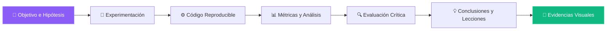

# Portafolio de Prácticas y Proyectos en IA

Bienvenido/a a mi portafolio académico y profesional de Inteligencia Artificial. Aquí documento <strong>todas las prácticas y proyectos</strong> del programa intensivo, con objetivos claros, metodología, resultados cuantitativos, evidencias visuales y reflexiones críticas.

  
16+Prácticas

  
5Unidades temáticas

  
25+Artículos extra

  
100%Completado

> *"Cada práctica es un desafío para conectar teoría, código y creatividad."*

---

## 🧭 UT1 — Machine Learning Clásico

Del análisis exploratorio a la validación rigurosa de modelos

-   :material-chart-scatter-plot:{ .lg .middle } __Práctica 1 — EDA del Titanic__

    ---

    Análisis exploratorio profundo, manejo de valores faltantes, visualización avanzada y detección de patrones de supervivencia.

    [:octicons-arrow-right-24: Ver práctica](01-primera-entrada.md){ .md-button .md-button--primary }

    <small>:material-plus-circle-outline: **Extra:** [EDA comparativa — Titanic vs. naufragios modernos](01x-titanic-extra.md)</small>

-   :material-cog:{ .lg .middle } __Práctica 2 — Feature Engineering__

    ---

    Imputación avanzada, variables dummies, feature crosses, interacción polinómica y baseline con regresión logística.

    [:octicons-arrow-right-24: Ver práctica](02-Feature-Engineering.md){ .md-button .md-button--primary }

    <small>:material-plus-circle-outline: **Extra:** [Feature Store mini — reproducibilidad y comparación](02x-feature-extra.md)</small>

-   :material-chart-line:{ .lg .middle } __Práctica 3 — Regresión Lineal y Logística__

    ---

    Comparación de modelos, métricas de evaluación, optimización del umbral de decisión y análisis de coeficientes.

    [:octicons-arrow-right-24: Ver práctica](02-Regresion-Lineal-Logistica.md){ .md-button .md-button--primary }

    <small>:material-plus-circle-outline: **Extra:** [Regresión robusta + Clasificación con umbral óptimo (ROC/PR)](03x-regresion-extra.md)</small>

-   :material-check-decagram:{ .lg .middle } __Práctica 4 — Validación y Selección de Modelos__

    ---

    Pipelines, KFold/StratifiedKFold, GridSearchCV, RandomizedSearchCV y selección del mejor candidato.

    [:octicons-arrow-right-24: Ver práctica](03-Validacion-Seleccion-deModelos.md){ .md-button .md-button--primary }

    <small>:material-plus-circle-outline: **Extra:** [Torneo XGBoost/LightGBM + curvas de aprendizaje](04x-model-selection-extra.md)</small>

-   :material-account-multiple:{ .lg .middle } __Práctica 5 — Clustering y PCA__

    ---

    K-Means, métricas Silhouette, elbow method y visualización con PCA sobre Mall Customers.

    [:octicons-arrow-right-24: Ver práctica](04-Clustering-PCA-Mall.md){ .md-button .md-button--primary }

    <small>:material-plus-circle-outline: **Extra:** [Clustering avanzado — GMM/DBSCAN + estabilidad](05x-clustering-extra.md)</small>

---

## 🤖 UT2 — Deep Learning Foundations

De perceptrones simples a redes profundas optimizadas

-   :material-robot-excited-outline:{ .lg .middle } __Práctica 7 — De Perceptrón a Redes Neuronales__

    ---

    Implementación manual del perceptrón, MLP desde cero y análisis de activaciones y pesos.

    [:octicons-arrow-right-24: Ver práctica](07-Perceptron-MLP.md){ .md-button .md-button--primary }

    <small>:material-plus-circle-outline: **Extra:** [Impacto de activaciones y optimizadores en la convergencia](07x-deep-learning-extra.md)</small>

-   :material-flask:{ .lg .middle } __Práctica 8 — Experimentación con MLPs__

    ---

    Curvas de pérdida, callbacks, regularización y evaluación sistemática de arquitecturas.

    [:octicons-arrow-right-24: Ver práctica](08-Experimentacions.md){ .md-button .md-button--primary }

    <small>:material-plus-circle-outline: **Extras:** [Regularización L1/L2 + Dropout](08x-experimentacions-extra.md) · [Profundidad vs. ancho](08b-deep-learning-extra.md) · [Adam vs SGD vs AdamW](08c-deep-learning-extra.md) · [Callbacks avanzados](08d-deep-learning-extra.md)</small>

---

## 🧠 UT3 — Computer Vision

Visión por computadora avanzada con CNNs, detección y segmentación

-   :material-image-filter-center-focus:{ .lg .middle } __Práctica 9 — CNNs y Transfer Learning__

    ---

    Arquitecturas propias + fine-tuning de VGG16, ResNet50 y MobileNetV2. Visualización de feature maps.

    [:octicons-arrow-right-24: Ver práctica](09-CNNs-Transfer-Learning.md){ .md-button .md-button--primary }

    <small>:material-plus-circle-outline: **Extra:** [ResNet50 vs EfficientNetB0 — eficiencia y precisión](09x-transfer-extra.md)</small>

-   :material-chart-bubble:{ .lg .middle } __Práctica 10 — Data Augmentation & XAI__

    ---

    Albumentations, Mixup, CutMix y explicabilidad con GradCAM e Integrated Gradients (Food-101).

    [:octicons-arrow-right-24: Ver práctica](10-Data-Augmentation-XAI.md){ .md-button .md-button--primary }

    <small>:material-plus-circle-outline: **Extra:** [Ablation study — impacto de cada técnica de augmentación](10x-augmentation-extra.md)</small>

-   :material-target-variant:{ .lg .middle } __Práctica 11 — YOLOv8 Detection & Tracking__

    ---

    Fine-tuning de YOLOv8 en dataset de frutas + tracking con IoU y DeepSORT en tiempo real.

    [:octicons-arrow-right-24: Ver práctica](11-YOLOv8-Detection.md){ .md-button .md-button--primary }

    <small>:material-plus-circle-outline: **Extras:** [DeepSORT vs ByteTrack](11xb-Extra_YOLO.md) · [YOLOv8 vs Faster R-CNN](11xc_YOLO_vs_FRCNN.md) · [Comparativa de tracking](11xd_tracking_comparacion.md)</small>

-   :material-shape-outline:{ .lg .middle } __Práctica 12 — SAM Segmentation__

    ---

    Segment Anything Model zero-shot vs. fine-tuning en crack segmentation (infraestructura).

    [:octicons-arrow-right-24: Ver práctica](12-SAM-Segmentation.md){ .md-button .md-button--primary }

    <small>:material-plus-circle-outline: **Extra:** [SAM 2 vs SAM original en datasets industriales](12x-sam-extra.md)</small>

---

## 🗣️ UT4 — Natural Language Processing

Transformers, RAG y agentes conversacionales inteligentes

-   :material-finance:{ .lg .middle } __Assignment 13 — BERT para Sentimiento Financiero__

    ---

    Fine-tuning de BERT/RoBERTa en FinancialPhrasebank + tweets, con análisis de atribuciones SHAP.

    [:octicons-arrow-right-24: Ver práctica](13-Finetuning-Transformers-Sentimiento.md){ .md-button .md-button--primary }

    <small>:material-plus-circle-outline: **Extra:** [RoBERTa Español, Embeddings y Métricas](13x-distillation-extra.md)</small>

-   :material-book-open-page-variant:{ .lg .middle } __Assignment 14 — Sistema RAG Completo__

    ---

    Pipeline RAG con FAISS/Chroma, embeddings de OpenAI y evaluación con RAGAS.

    [:octicons-arrow-right-24: Ver práctica](14-RAG-LangChain.md){ .md-button .md-button--primary }

    <small>:material-plus-circle-outline: **Extra:** [RAG avanzado — HyDE + Self-Query Retriever](14x-rag-advanced.md)</small>

-   :material-robot:{ .lg .middle } __Assignment 15 — Agentes con LangGraph__

    ---

    Agentes reactivos con LangGraph: tool calling, memoria conversacional y orquestación multi-agente.

    [:octicons-arrow-right-24: Ver práctica](15-Agentes-LangGraph.md){ .md-button .md-button--primary }

    <small>:material-plus-circle-outline: **Extra:** [Agente con ReAct + auto-reflexión](15x-agentes-react.md)</small>

---

## ⚙️ UT5 — MLOps & DataOps

Del notebook al sistema en producción escalable

-   :material-factory:{ .lg .middle } __Assignment 16 — Pipeline MLOps End-to-End__

    ---

    DVC + MLflow + Prefect + FastAPI + Docker + Evidently AI + GitHub Actions + Deploy (Railway).

    [:octicons-arrow-right-24: Ver práctica](16-MLOps-End-to-End.md){ .md-button .md-button--primary }

    <small>:material-plus-circle-outline: **Extra:** [Monitoreo con Prometheus + Grafana](16x-monitoring-extra.md)</small>

---

## 🔄 Flujo de documentación profesional

